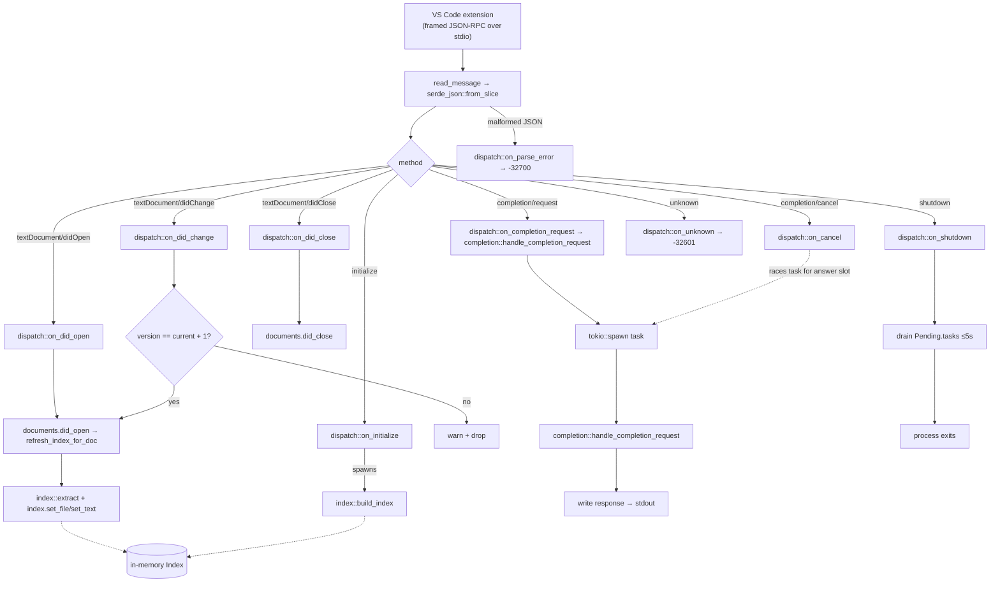

# sidecar

Per-window Rust process that does the smart work of the completion pipeline. Spawned by the VS Code extension over stdio, talks to the inference server directly, posts fire-and-forget telemetry to Phoenix.

## What it does

Every keystroke in the editor becomes a JSON-RPC frame on stdin. A single frame
loop in [`src/lib.rs`](./src/lib.rs) reads `Content-Length`-framed messages
and hands each one to a handler in [`src/dispatch.rs`](./src/dispatch.rs).



What each event **does**, in one line:

| Event                    | Handler                                                | Effect                                                                                                 |
| ------------------------ | ------------------------------------------------------ | ------------------------------------------------------------------------------------------------------ |
| `initialize`             | [`dispatch::on_initialize`](./src/dispatch.rs)         | Parse params → `Config`; spawn background `index::build_index`.                                        |
| `textDocument/didOpen`   | [`dispatch::on_did_open`](./src/dispatch.rs)           | Insert into `Documents`; refresh the file's entry in the index.                                        |
| `textDocument/didChange` | [`dispatch::on_did_change`](./src/dispatch.rs)         | Replace text if version == current+1; swallow stale silently; refresh index.                           |
| `textDocument/didClose`  | [`dispatch::on_did_close`](./src/dispatch.rs)          | Drop the document.                                                                                     |
| `completion/request`     | [`dispatch::on_completion_request`](./src/dispatch.rs) | Spawn a cancellable task that runs [`completion::handle_completion_request`](./src/completion/mod.rs). |
| `completion/cancel`      | [`dispatch::on_cancel`](./src/dispatch.rs)             | Claim the answer slot, write `-32003`, abort the task.                                                 |
| `shutdown`               | [`dispatch::on_shutdown`](./src/dispatch.rs)           | Drain in-flight task handles ≤ 5 s, reply `null`, exit.                                                |

See [`docs/completion-flow.md`](./docs/completion-flow.md) for the inside of
`handle_completion_request`, and [`docs/index-build.md`](./docs/index-build.md)
for how the workspace index gets populated.

## Layout

```
src/
  main.rs          # tracing init, sidecar::run
  lib.rs           # frame loop (see diagram above)
  dispatch.rs      # one on_* per JSON-RPC method, cancellation race
  state.rs         # Config + Pending (cancellation bookkeeping)
  rpc.rs           # Content-Length framing, JsonRpcError
  documents.rs     # HashMap<Uri, Document>, version checks
  completion/      # handler pipeline
    mod.rs         #   handle_completion_request, Debounce
    cap.rs         #   UTF-8-safe byte-cap helpers
  syntax.rs        # tree-sitter Lang enum (14 languages) + NoParser
  index/           # the workspace index
    mod.rs         #   Index struct + Symbol
    extract.rs     #   per-language tree-sitter extractors
    bm25.rs        #   tokenizer + ranker
    walk.rs        #   build_index one-shot walk
  context/         # repository_context assembly
    mod.rs         #   public surface + selection logic
    fmt.rs         #   symbol-line formatting
  inference.rs     # FIM prompt + HTTP call
  telemetry.rs     # fire-and-forget POST

tests/             # integration tests, mirrors src/
docs/              # the two flow diagrams linked above
```

No `#[cfg(test)]` code in `src/` — tests live under [`tests/`](./tests/) and
exercise the public API only.

## Build

```sh
export PATH="$HOME/.cargo/bin:$PATH"
cargo build
```

## Tests

Integration tests in [`tests/`](./tests/) mirror `src/`:

```sh
cargo test
```

## Lint and format

Ruff-style targets on the workspace [`Makefile`](../Makefile). Run from the repo root:

```sh
make sidecar-lint       # report only — clippy + missing_docs
make sidecar-lint-fix   # clippy --fix + cargo fmt
```

## Run

Standalone, the binary sits silently on stdin. Drive it with a framed `printf`
chain — initialize, two `didOpen`, one `completion/request`, one `shutdown`.
`${#m}` computes each `Content-Length` so you can edit the JSON freely:

```sh
{
  m='{"jsonrpc":"2.0","id":1,"method":"initialize","params":{"workspace_root":"file:///tmp","telemetry_url":"","telemetry_api_key":""}}'
  printf 'Content-Length: %d\r\n\r\n%s' ${#m} "$m"

  m='{"jsonrpc":"2.0","method":"textDocument/didOpen","params":{"uri":"file:///tmp/utils.py","language":"python","version":1,"text":"def format_greeting(name):\n    return f\x27Hello, {name}!\x27\n"}}'
  printf 'Content-Length: %d\r\n\r\n%s' ${#m} "$m"

  m='{"jsonrpc":"2.0","method":"textDocument/didOpen","params":{"uri":"file:///tmp/main.py","language":"python","version":1,"text":"from utils import format_greeting\n\ndef main():\n    x = format_greeting(\"world\")\n"}}'
  printf 'Content-Length: %d\r\n\r\n%s' ${#m} "$m"

  m='{"jsonrpc":"2.0","id":2,"method":"completion/request","params":{"document_uri":"file:///tmp/main.py","document_version":1,"position":{"line":3,"character":25}}}'
  printf 'Content-Length: %d\r\n\r\n%s' ${#m} "$m"

  sleep 2   # keep the stdin open past the 200 ms debounce + inference
  m='{"jsonrpc":"2.0","id":3,"method":"shutdown"}'
  printf 'Content-Length: %d\r\n\r\n%s' ${#m} "$m"
} | ./target/debug/sidecar 2>/dev/null \
  | awk 'NF' RS='Content-Length: [0-9]+\r\n\r\n' | jq .
```

## Config (from `initialize` JSON-RPC call)

| Param               | Type           | Default     | Used for                         |
| ------------------- | -------------- | ----------- | -------------------------------- |
| `workspace_root`    | string         | —           | Workspace URI; sets index scope  |
| `telemetry_url`     | string         | —           | Telemetry sink URL (empty = off) |
| `telemetry_api_key` | string         | —           | Bearer for telemetry sink        |
| `model_url`         | string or null | —           | Inference base URL (null = mock) |
| `model_api_key`     | string or null | —           | Bearer for inference             |
| `model`             | string or null | `"default"` | Model id sent to inference       |
| `fim_template`      | string or null | Starcoder   | FIM prompt template              |
| `temperature`       | number or null | `0.0`       | Sampling temperature             |
| `max_tokens`        | number or null | `32`        | Output token cap                 |

Anything else in `initialize.params` is ignored (forward-compat).

## Cross-cutting refs

- Wire protocol (frozen v1.2): [`../protocol/README.md`](../protocol/README.md)
