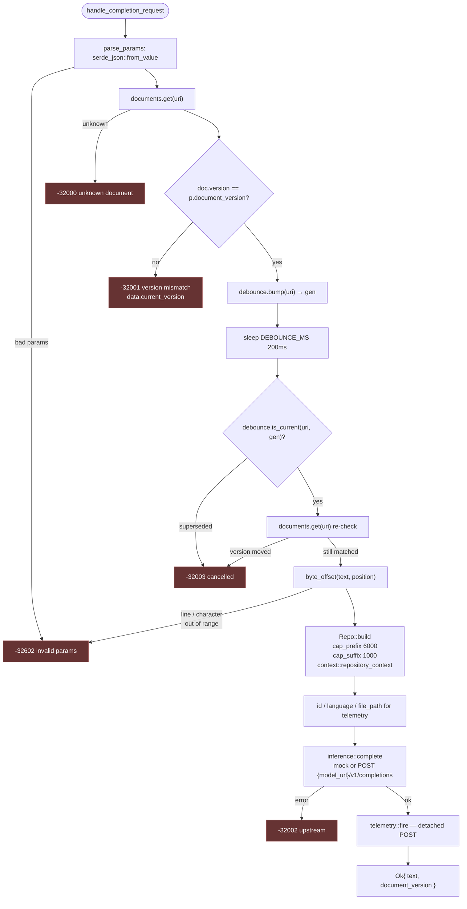

# `handle_completion_request` — end-to-end flow

One JSON-RPC `completion/request` in, one `{text, document_version}` reply out.
Lives in [`../src/completion/mod.rs`](../src/completion/mod.rs). Error codes
are protocol-mandated and ordered; see
[`../../protocol/README.md`](../../protocol/README.md) §2.2.

The same list in words:

1. **Validate** — [`parse_params`](../src/completion/mod.rs) deserializes `params`.
2. **Lookup** — `documents.get(uri)`; unknown documents drop out as `-32000`.
3. **Version gate** — request's `document_version` must equal the document's
   current version; otherwise `-32001` carrying the live version so the client
   can resync.
4. **Debounce** — [`debounce_recheck`](../src/completion/mod.rs) bumps the
   per-URI generation, sleeps `DEBOUNCE_MS`, then refuses `-32003` if a newer
   request claimed the slot OR the document version moved while we slept.
5. **Offset** — [`byte_offset`](../src/completion/mod.rs) flattens
   `{line, character}` to a single byte offset in the document text.
6. **Prompt bits** — [`Repo::build`](../src/completion/mod.rs) caps prefix /
   suffix by bytes and pulls `repository_context` via
   [`context::repository_context`](../src/context/mod.rs).
7. **Call inference** — [`inference::complete`](../src/inference.rs); mock if
   `model_url` is unset, otherwise OpenAI-compatible POST.
8. **Telemetry** — fire-and-forget POST to Phoenix via
   [`telemetry::fire`](../src/telemetry.rs). Never awaits the response path.
9. **Reply** — `{text, document_version}` — same version we validated, so a
   racing `didChange` still surfaces client-side.

## Cancellation hand-off

This handler doesn't know about cancellation — the racing partner is
[`dispatch::on_cancel`](../src/dispatch.rs). The task wraps this fn in a
`tokio::spawn` and claims `answered.insert(id)` before writing. If a cancel
got there first, the response is silently dropped.
