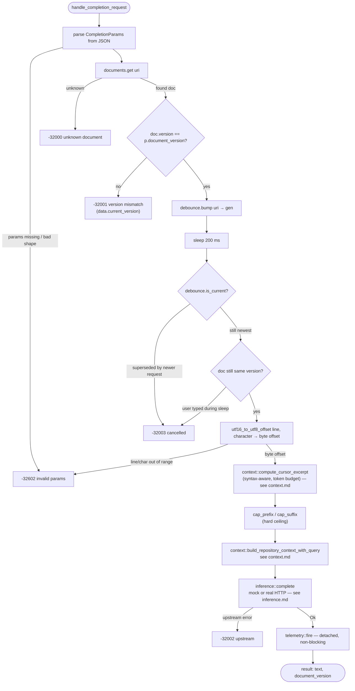

# `completion.rs` — `completion/request` end-to-end

The single handler for the JSON-RPC `completion/request` method. Validates the
request against the live document table, trims the file into a prompt that fits
the HTTP budget, calls inference, and returns the completion. Two non-obvious
pieces live here: **UTF-16 → UTF-8 position conversion** (VS Code speaks UTF-16
code units, Rust slices in bytes) and **latest-wins debounce** (typing bursts
collapse into one HTTP call).

Source: [`../src/completion.rs`](../src/completion.rs).

## Algorithm

**Debounce.** Every incoming request per URI bumps a generation counter, sleeps
`DEBOUNCE_MS` (200 ms), then checks if its generation is still newest. If a
newer request bumped the counter while we slept, the older one returns `-32003`
(cancelled) and never reaches the HTTP hop. After the sleep we re-check the
document version — typing during the 200 ms window invalidates the version we
validated on entry, so the debounced request also bails with `-32003` rather
than answer against a stale snapshot.

**Offset conversion.** `utf16_to_utf8_offset` walks the buffer line-by-line to
find the target line, then iterates `char`s on that line summing `len_utf16()`
until it hits `target_char`. If the cursor lands mid-surrogate-pair (between
the high and low halves of an emoji), we return the boundary *before* the pair
— frozen behavior, see `../../protocol/README.md` §4.

**Capping.** `cap_prefix` takes the *last* N bytes of prefix and `cap_suffix`
takes the *first* N bytes of suffix; both walk inward to a UTF-8 char boundary
so we never split a multi-byte codepoint at the cut. The caps
(`PREFIX_CAP = 6000`, `SUFFIX_CAP = 1000`) are a hard ceiling on top of the
syntax-aware excerpt, which in practice already comes in well below them. See
[`context.md`](./context.md) for the excerpt algorithm itself.

## Public API

| Item | Signature | Purpose |
|---|---|---|
| `Debounce` | `struct`, `Clone` | Per-URI generation counter for latest-wins debounce |
| `Debounce::bump` | `async fn bump(&self, uri: &str) -> u64` | Claim the next generation for `uri` |
| `Debounce::is_current` | `async fn is_current(&self, uri: &str, gen: u64) -> bool` | True if `gen` is still the newest |
| `utf16_to_utf8_offset` | `fn utf16_to_utf8_offset(text: &str, line: usize, char: usize) -> Result<usize, JsonRpcError>` | Protocol position → byte offset |
| `cap_prefix` | `fn cap_prefix(s: &str, max: usize) -> &str` | Last `max` bytes, char-boundary-safe |
| `cap_suffix` | `fn cap_suffix(s: &str, max: usize) -> &str` | First `max` bytes, char-boundary-safe |
| `handle_completion_request` | `async fn handle_completion_request(cfg, docs, idx, req, debounce) -> Result<Value, JsonRpcError>` | Full request pipeline |

## Flow

## Error-code precedence

Protocol-mandated: `-32602` (bad params) → `-32000` (unknown document) →
`-32001` (version mismatch) → `-32003` (debounce / race) → `-32002` (upstream).
Don't reorder — the extension's version-recovery depends on `-32001` arriving
before any debounce/cancel verdict. See [`../../protocol/README.md`](../../protocol/README.md)
§2.2.
