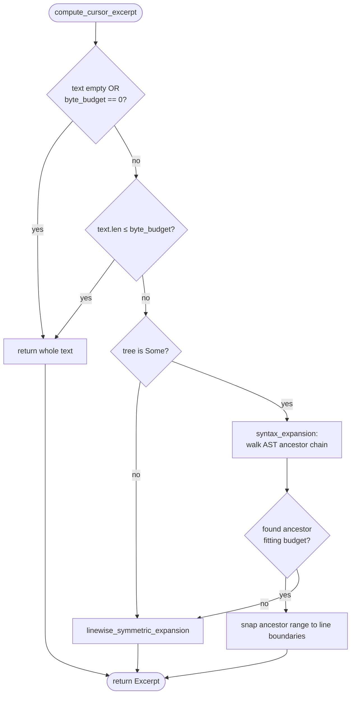
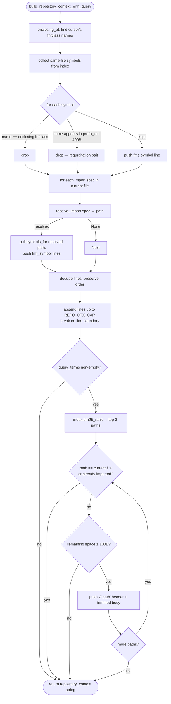
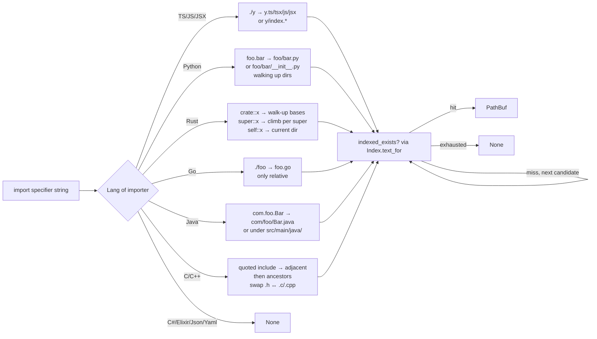

# `context/` — repository-context assembly

Builds the `repository_context` string that goes into the FIM prompt's
`# Related symbols:` block. Two jobs:

- **Cursor excerpt**: pick a slice of the current buffer centered on the cursor
  that fits the token budget (`compute_cursor_excerpt`).
- **Repo context**: rank and format symbols/excerpts from the rest of the
  workspace (`build_repository_context_with_query`). Pulls from the in-memory
  [`Index`](../src/index/mod.rs) — never touches disk.

Source: [`../src/context/mod.rs`](../src/context/mod.rs) +
[`../src/context/fmt.rs`](../src/context/fmt.rs) +
[`../src/context/resolve.rs`](../src/context/resolve.rs).

Split into three files: `mod.rs` is the public surface + assembly logic,
`fmt.rs` formats one symbol line, `resolve.rs` maps per-language import
specifiers (`import x from "./y"`, `use crate::foo`, etc.) to repo-relative
paths so we can pull their symbols.

## Algorithm

### Cursor excerpt — `compute_cursor_excerpt`

Tries **syntax-aware expansion** first: start at the cursor's innermost AST
node, walk up the parent chain, and keep the largest ancestor whose byte range
fits `token_budget × BYTES_PER_TOKEN_GUESS` (= 3 bytes/token, a Zed bleed-off
heuristic). Snap to line boundaries so the excerpt reads like code, not a
substring. If the syntax tree is missing, or even the innermost block
overflows the budget, fall back to **linewise symmetric expansion** — seed
with the cursor's line, then alternately extend down one line and up one line,
charging `max(1, bytes/3)` tokens per line until the budget runs out.

### Repo context — `build_repository_context_with_query`

1. **Same-file symbols.** Take every symbol the index has for the current
   file. **Drop** (a) the enclosing function/class name at the cursor (it's
   literally in the prompt) and (b) any name already present in the last ~400
   bytes before the cursor — freshly typed declarations would otherwise be
   echoed back as "context."
2. **Imported files' symbols.** For each import specifier in the current file,
   resolve to a real path via `resolve_import` and pull that file's symbols
   from the index. Dedupe and prefix each line with the resolved path.
3. **BM25-ranked repo excerpts.** Rank every other indexed file against
   `query_terms` (identifiers pulled from ±3 lines around the cursor). Take
   the top 3 that aren't the current file or already covered by imports, and
   splice in up to whatever bytes remain of `REPO_CTX_CAP` (2000).

The final string is truncated at `REPO_CTX_CAP` bytes, always on a line
boundary.

### Import resolution — `resolve.rs`

Per-language dispatch in `resolve_import_for`; each resolver knows one
language's specifier shape and tries candidate paths against the index (the
index's `set_text` map is the "does this file exist" oracle — no disk
touches):

| Lang | Specifier | Tries |
|---|---|---|
| TS/JS | `"./y"` or `"../z"` | `./y.{ts,tsx,js,jsx}`, `./y/index.*`, literal if spec ends in a known ext |
| Python | `"foo.bar"`, `"foo"`, `".foo"`, `"..foo"` | `foo/bar.py`, `foo/bar/__init__.py`, walking up from importer |
| Rust | `crate::foo::Bar`, `super::foo`, `self::foo` | `foo/bar.rs`, `foo/bar/mod.rs` under candidate bases |
| Go | `"./foo"` | `./foo.go` (real module paths skipped — no `go.mod` parsing) |
| Java | `"com.foo.Bar"` | `com/foo/Bar.java` under any ancestor, or under `src/main/java/` |
| C/Cpp | `"foo.h"` | Adjacent, then ancestor dirs; also `.h ↔ .c/.cc/.cpp/.cxx` swap |
| C#/Elixir/Json/Yaml | — | Not resolved (returns `None`) |

## Public API

| Item | Signature | Purpose |
|---|---|---|
| `REPO_CTX_CAP` | `const usize = 2000` | Hard byte cap on the output string |
| `BYTES_PER_TOKEN_GUESS` | `const usize = 3` | Token→byte conversion heuristic |
| `Excerpt` | `struct { start_byte, end_byte, cursor_offset_in_excerpt }` | Byte-range slice + projected cursor |
| `compute_cursor_excerpt` | `fn compute_cursor_excerpt(text, tree, cursor_offset, token_budget) -> Excerpt` | Cursor-centered slice under a token budget |
| `linewise_symmetric_expansion` | `fn linewise_symmetric_expansion(text, cursor, byte_budget) -> (usize, usize)` | Fallback when no syntax tree |
| `identifiers_near_cursor` | `fn identifiers_near_cursor(text, cursor_offset, radius_lines) -> Vec<String>` | Deduped identifier tokens ±N lines (≤12) |
| `Enclosing` | `struct { function, class }` | Innermost function/class names at cursor |
| `enclosing_at` | `fn enclosing_at(tree, text, byte_offset) -> Enclosing` | AST walk to find enclosing fn/class |
| `build_repository_context` | `async fn build_repository_context(index, current_file, tree, text, byte_offset) -> String` | Convenience: extracts identifiers itself |
| `build_repository_context_with_query` | `async fn build_repository_context_with_query(..., query_terms) -> String` | Main entry — caller passes query terms |
| `resolve_import` | `async fn resolve_import(index, current_file, spec) -> Option<PathBuf>` | Dispatch by importer's extension |
| `resolve_import_for` | `async fn resolve_import_for(index, lang, current_file, spec) -> Option<PathBuf>` | Dispatch by explicit `Lang` |
| `resolve_{ts,python,rust,go,java,c}_*` | per-language resolvers | Spec → repo-relative path |

## Flow

### `compute_cursor_excerpt`

### `build_repository_context_with_query`

### `resolve_import_for` — per-language dispatch

