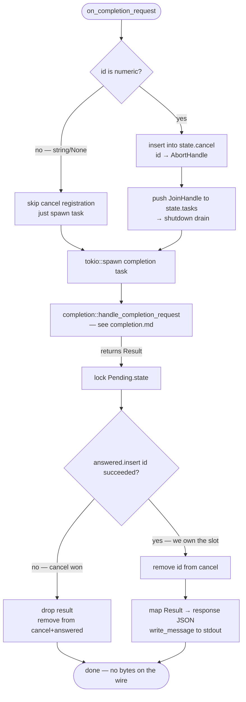
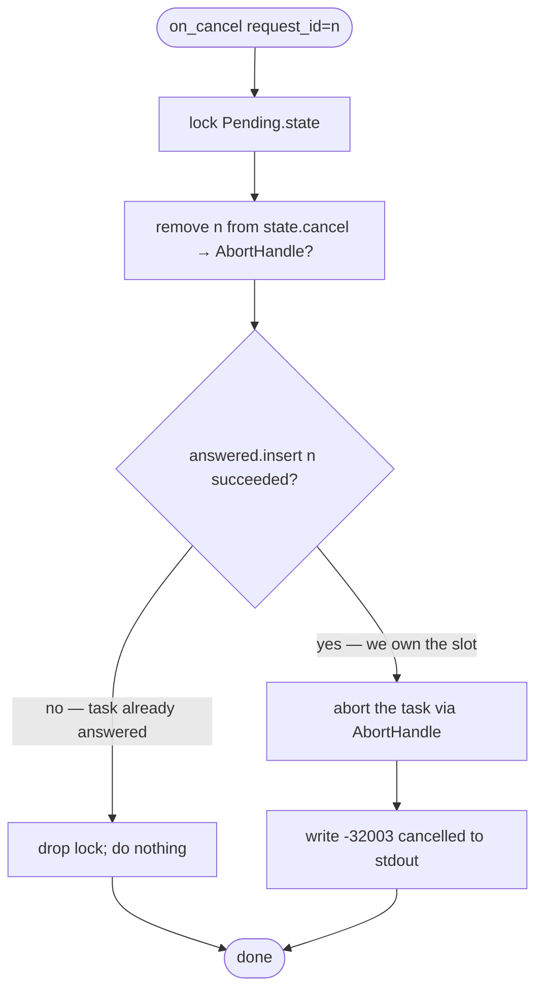
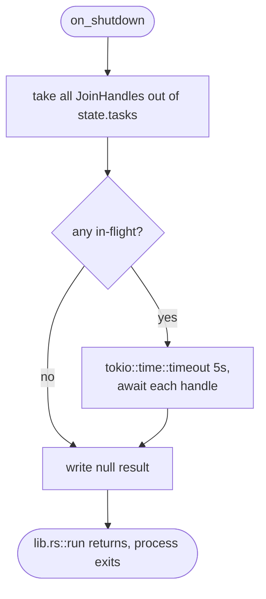

# `dispatch.rs` — JSON-RPC method handlers + cancellation race

One `pub async fn on_*` per JSON-RPC method, called from the frame loop in
[`lib.rs::run`](../src/lib.rs). Holds the handler-level orchestration: how
`initialize` stashes config and kicks off background indexing, how `completion`
spawns work in a `tokio::spawn`ed task and coordinates with `cancel`, and how
`didOpen`/`didChange`/`didClose` keep the document table and the workspace
index fresh.

Source: [`../src/dispatch.rs`](../src/dispatch.rs) +
[`../src/state.rs`](../src/state.rs) (the `Config` / `Pending` types shared
across handlers) + [`../src/lib.rs`](../src/lib.rs) (the frame→handler
mapping).

## Algorithm

**Cancellation race.** The invariant is: *for every numeric request id, exactly
one response goes on the wire* — either the spawned completion task writes its
result, or the cancel handler writes `-32003`. Both halves grab the same
`Pending.state` mutex at the key moments so no response can ever be emitted
twice:

- The completion task, **after** calling `handle_completion_request`, locks
  `state` and tries `answered.insert(id)`. If it returns `false`, a cancel
  already claimed this id — drop the result and clean up. If `true`, this task
  owns the response slot; write the result.
- The cancel handler, upon `completion/cancel`, locks `state`, removes the
  task's `AbortHandle`, and **itself** tries `answered.insert(id)`. If that
  returns `false`, the task already claimed the response — do nothing. If
  `true`, abort the task and write `-32003` right away.
- The task registers itself in `state.cancel` (abort handle) **before** the
  race window opens, and pushes its `JoinHandle` into `state.tasks` so
  `shutdown` can drain in-flight work with a 5 s ceiling.

**Background indexing.** `initialize` spawns a `tokio::spawn` that walks the
workspace via [`index::build_index`](../src/index/mod.rs) — completions never
block on it. `refresh_index_for_doc` re-extracts symbols and imports for a
single file on each `didOpen`/`didChange`, so the index stays warm for
whatever the user has open without another walk.

**`didChange` ordering.** Version mismatch → log a `warn` and leave the
document untouched. *Not* an error response — `didChange` is a notification,
and protocol-level version drift is reported on the next `completion/request`
via `-32001` (which the extension uses to resync).

## Public API

Each `on_*` is one JSON-RPC method handler:

| Handler | Method | Response |
|---|---|---|
| `on_initialize` | `initialize` | `{}` or `-32602` |
| `on_shutdown` | `shutdown` | `null`, drains in-flight tasks ≤5 s |
| `on_completion_request` | `completion/request` | spawns task — real response written by the task itself |
| `on_cancel` | `completion/cancel` (notification) | writes `-32003` iff cancel wins the race |
| `on_did_open` / `on_did_change` / `on_did_close` | `textDocument/did*` (notifications) | none |
| `on_unknown` | any other request | `-32601` |
| `on_parse_error` | — (malformed JSON) | `-32700` |

Plus one pub helper:

| Item | Signature | Purpose |
|---|---|---|
| `Writer` | `pub type Writer = Arc<Mutex<tokio::io::Stdout>>` | Shared stdout, one mutex per process |
| `repo_relative_str` *(re-exported from `state.rs`)* | `fn repo_relative_str(root, uri) -> String` | `file:///repo/x.ts` → `x.ts` for telemetry `file_path` |

`Config` and `Pending` (shared state) live in [`state.rs`](../src/state.rs) —
the header docs there are the source of truth for their invariants.

## Flow

### `on_completion_request` — spawn & coordinate

### `on_cancel` — notification handler racing a spawned task

### `on_shutdown`

