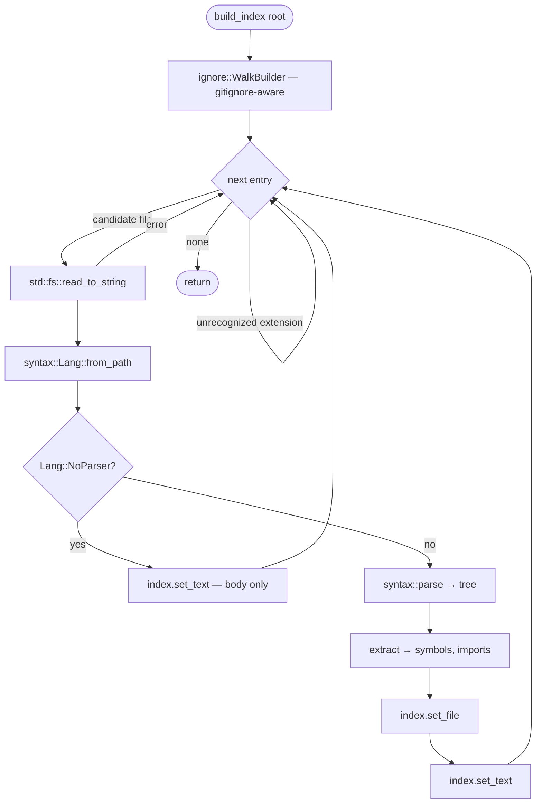
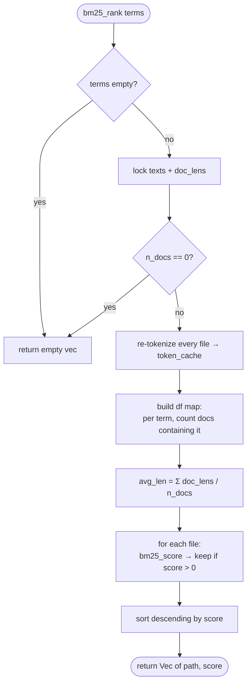
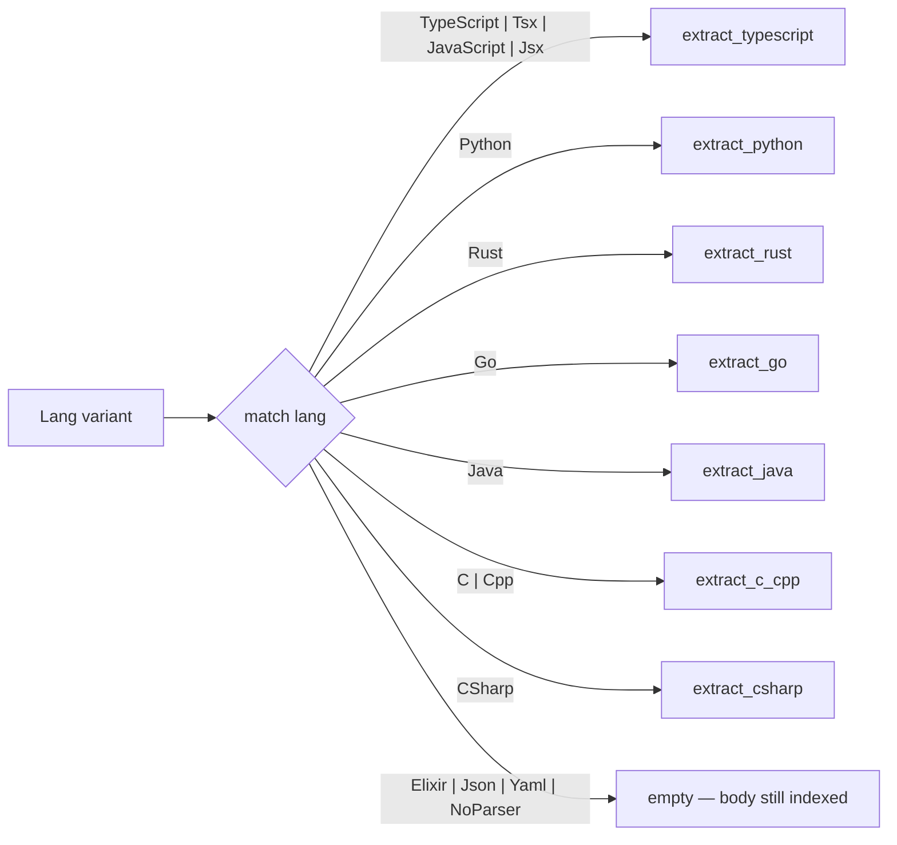

# `index/` — workspace symbol index + BM25 ranker

In-memory index of every source file the workspace walker finds. Built once in
the background on `initialize`, refreshed per-file on every `didOpen` /
`didChange` (via [`dispatch::refresh_index_for_doc`](../src/dispatch.rs)).
Serves three consumers:

- [`context/`](../src/context/mod.rs) pulls symbols and import specifiers to
  assemble `repository_context` lines (→ [`context.md`](./context.md)).
- [`completion.rs`](../src/completion.rs) pulls full file bodies for BM25
  ranking against cursor-window identifiers.
- [`inference.rs`](../src/inference.rs) never touches this directly — it just
  receives the formatted string.

Source: [`../src/index/mod.rs`](../src/index/mod.rs) (storage + ranking) +
[`../src/index/extract.rs`](../src/index/extract.rs) (per-language tree-sitter
extractors).

## Algorithm

**Storage.** Three parallel `HashMap<PathBuf, _>`s behind `RwLock`, all keyed
by workspace-relative path with forward slashes:

| Map                  | Contents                                                                     |
| -------------------- | ---------------------------------------------------------------------------- |
| `inner`              | `Vec<Symbol>` — top-level declarations per file                              |
| `imports`            | `Vec<String>` — raw import specifiers as written (`"./y"`, `"use crate::x"`) |
| `texts` + `doc_lens` | full source + token-length cache for BM25                                    |

Cheap `Clone` — clones share the same `Arc`, so every request handler works
against the same data.

**Symbol extraction** (`extract.rs`). One function per grammar group, each a
shallow tree-sitter walk that pulls a fixed set of top-level node kinds into
`Symbol` records and a list of import specifiers. `NoParser` /
`Json` / `Yaml` / `Elixir` produce no symbols (their bodies still feed BM25).

**Tokenizer** (`tokenize`). Lowercases, splits on non-alphanumeric, split
`snake_case` on `_`, and splits `camelCase` on `lowercase→Uppercase` boundaries.
So `getUserName` → `["get","user","name"]`, `USER_ID` → `["user","id"]`.

**BM25 ranker** (`bm25_score`). Standard Robertson–Spark-Jones BM25 with
`k1=1.5, b=0.75`. For candidate doc `d` and query `Q`:

$\text{score}(d,Q) = \sum_{q \in Q} \text{idf}(q) \cdot \frac{tf(q,d)\,(k_1+1)}{tf(q,d) + k_1\,(1 - b + b\,\frac{len_d}{avglen})}$

$$\text{idf}(q) = \ln\!\left(\frac{N - df(q) + 0.5}{df(q) + 0.5} + 1\right)$$

Very common terms (`df → N`) get clamped so the IDF never goes negative.
`bm25_rank` tokenizes every cached file each call

## Public API

| Item                                                    | Signature                                                           | Purpose                                              |
| ------------------------------------------------------- | ------------------------------------------------------------------- | ---------------------------------------------------- |
| `Symbol`                                                | `struct { name, kind, line, lang }`                                 | One top-level declaration; `line` is 0-based         |
| `Index`                                                 | `struct`, `Clone`                                                   | All four maps under `Arc`s                           |
| `set_file`                                              | `async fn set_file(&self, path, symbols, imports)`                  | Replace symbols + imports for one path               |
| `set_text`                                              | `async fn set_text(&self, path, text)`                              | Replace body + refresh token-length cache            |
| `text_for` / `symbols_for` / `imports_of` / `all_paths` | `async fn …(&self, …)`                                              | Read-side snapshots                                  |
| `bm25_rank`                                             | `async fn bm25_rank(&self, terms: &[&str]) -> Vec<(PathBuf, f64)>`  | Ranked paths, descending score, zero-scorers dropped |
| `tokenize`                                              | `fn tokenize(text: &str) -> Vec<String>`                            | Lowercase identifier tokens                          |
| `bm25_score`                                            | `fn bm25_score(q, doc_tokens, doc_len, avg_len, n_docs, df) -> f64` | Single-document BM25                                 |
| `extract`                                               | `fn extract(lang, tree, text) -> (Vec<Symbol>, Vec<String>)`        | Per-language dispatcher → `extract.rs`               |
| `build_index`                                           | `async fn build_index(root, index)`                                 | Initial workspace walk, populates everything         |

## Flow

### `build_index` — one-time workspace walk

### `bm25_rank` — per-request scoring

### `extract` — per-language dispatch (source of truth: `index/extract.rs`)

