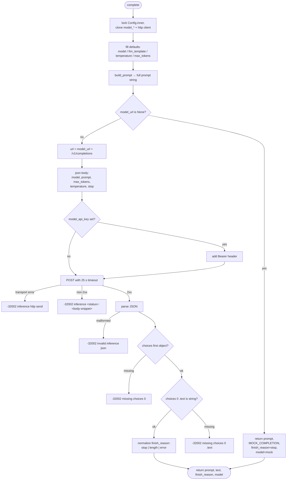

# `inference.rs` — FIM prompt assembly + HTTP call

Port of Phoenix's `Complete.FimAdapter` to Rust. Two functions: one that
renders the FIM prompt string, one that POSTs it. When `model_url` is unset
the module short-circuits to a static mock so the e2e developer loop works
without any inference server running.

Source: [`../src/inference.rs`](../src/inference.rs).

## Algorithm

**Prompt layout.** One layout, always:

```
# Path: <repo-relative path>
# Related symbols:            ← omitted when repository_context is empty
<repository_context lines>
<FIM template with {prefix} and {suffix} spliced>
```

The default template is the Starcoder chain
`<|fim_prefix|>{prefix}<|fim_suffix|>{suffix}<|fim_middle|>`; a user-supplied
`fim_template` replaces it verbatim (so `{prefix}` / `{suffix}` placeholders
must appear in it — anything else is sent as literal text).

**Mock short-circuit.** If `Config.model_url` is `None`, `complete` returns
`(prompt, MOCK_COMPLETION, "stop", "mock")` *without opening a socket*. The
static mock string is the marker `// hello from mock backend` — grep for it
when tracing or debugging.

**Real call.** POST `{model_url}/v1/completions` (OpenAI-compatible), Bearer
auth iff `model_api_key` is set. Sensible defaults:

| Field | Default | Why |
|---|---|---|
| `temperature` | `0.0` | Ghost text wants determinism |
| `max_tokens` | `32` | Ghost text, not codegen |
| `stop` | `["\n\n\n", "```", "<|fim_middle|>", "<|fim_suffix|>"]` | Keep instruction-tuned models from chatting past the midpoint |
| Timeout | 25 s | Long enough for CPU-bound local servers |

Errors map to JSON-RPC `-32002 upstream`. The response must be a well-formed
OpenAI `choices[0].text` — anything else (missing key, non-2xx status,
unparseable JSON) is `-32002` with a short diagnostic. `finish_reason` is
normalized to `"stop"` / `"length"` / `"error"` — anything unrecognized
collapses to `"error"`.

## Public API

| Item | Signature | Purpose |
|---|---|---|
| `DEFAULT_FIM_TEMPLATE` / `MOCK_COMPLETION` / `STOP_SEQUENCES` | `const` | Behavior constants (see source) |
| `CompleteResult` | `type CompleteResult = (String, String, String, String)` | `(prompt, completion, finish_reason, model)` |
| `build_prompt` | `fn build_prompt(file_path, repository_context, fim_template, prefix, suffix) -> String` | Pure string assembly — no I/O |
| `complete` | `async fn complete(cfg, language, file_path, prefix, suffix, repository_context, request_id) -> Result<CompleteResult, JsonRpcError>` | Mock or HTTP |

## Flow


